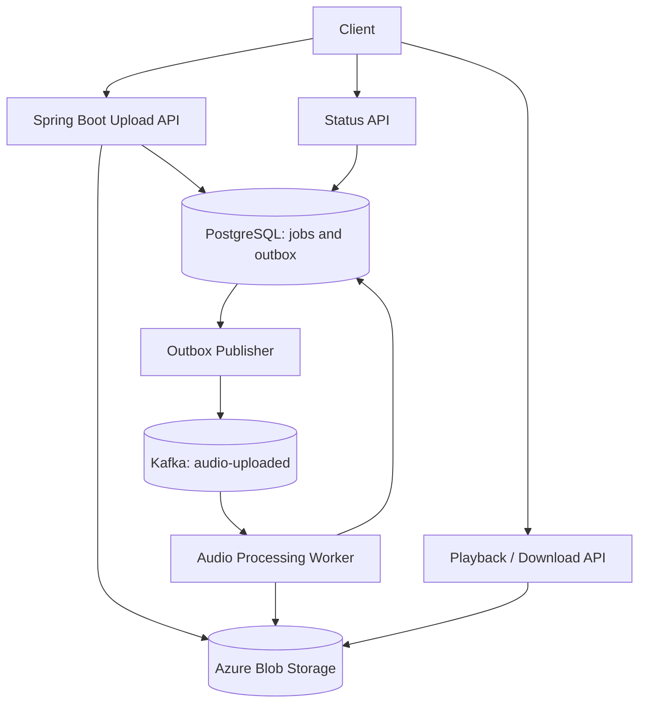

# AudioFlow — Asynchronous Audio Processing with Kafka

AudioFlow is a learning project that accepts audio uploads, processes them asynchronously, stores the resulting audio in object storage, and makes it available for playback.

The MVP focuses on **event-driven architecture and reliable asynchronous processing**. Later iterations can add dead-letter queues (DLQs), replay tooling, Spark analytics, and failure dashboards.

## Goals

- Upload an audio file without waiting for processing to finish.
- Publish an `AudioUploaded` event to Kafka.
- Process audio in a background worker.
- Store original and processed files in Azure Blob Storage.
- Track workflow status in PostgreSQL.
- Let clients check status and play/download the processed file.
- Run the development environment locally with Docker Compose.

## MVP scope

### Included

1. Upload audio through a REST API.
2. Store the original file in Blob Storage.
3. Record the upload and processing status in PostgreSQL.
4. Publish an event to Kafka.
5. Consume the event in a background worker.
6. Apply one simple audio transformation, such as WAV conversion or volume normalization.
7. Upload the processed file and mark the job `READY`.
8. Expose status and playback/download endpoints.

### Deferred until a later iteration

- Spark Structured Streaming analytics
- DLQ and retry topics
- User-controlled replay
- Multiple independent processing stages
- Authentication and multi-tenant access control
- Production-scale deployment, autoscaling, and alerting

> **Reliability note:** The MVP should not silently lose jobs if a database write succeeds but Kafka publication fails. Implement a transactional outbox, or explicitly document and test a simpler interim approach. The outbox is the recommended option and can be included in the MVP if reliability is a primary learning goal.

## Architecture



### Request lifecycle

1. The client sends an audio file to `POST /api/v1/audio`.
2. The API validates the file, generates an `audioId`, uploads the original to Blob Storage, and records a job with status `PENDING`.
3. The API writes an `AudioUploaded` event to an outbox table in the same PostgreSQL transaction as the job record.
4. An outbox publisher sends pending events to Kafka and marks them published after broker acknowledgement.
5. The worker consumes `AudioUploaded`, changes the job to `PROCESSING`, downloads the original audio, and performs the transformation.
6. The worker uploads the processed artifact to Blob Storage and updates the job to `READY`.
7. The client polls the status endpoint. Once ready, it uses the playback/download endpoint.

The outbox publisher can publish an event more than once if it crashes after Kafka acknowledges the event but before the outbox row is marked published. Consumers must therefore be designed for duplicate delivery.

## Technology choices

| Component | Technology | Responsibility |
|---|---|---|
| API and worker | Java 17+ / Spring Boot 3 | REST endpoints, event production and consumption |
| Event broker | Apache Kafka | Asynchronous work queue and event distribution |
| Database | PostgreSQL | Job status, artifact metadata, outbox and idempotency |
| Object storage | Azure Blob Storage | Original and processed audio files |
| Audio processing | FFmpeg or an audio library | Simple conversion/normalization |
| Local environment | Docker Compose | Run dependencies locally |
| Build | Maven | Compile, test, and package |

Use a supported Java LTS version compatible with the selected Spring Boot release. Pin container image versions in `compose.yaml` rather than relying on `latest`.

## Suggested repository layout

```text
audioflow/
├── README.md
├── compose.yaml
├── .env.example
├── pom.xml
├── src/
│   ├── main/java/com/example/audioflow/
│   │   ├── api/             # Upload, status and playback endpoints
│   │   ├── application/     # Upload and processing use cases
│   │   ├── domain/          # AudioJob, status, event models
│   │   ├── messaging/       # Kafka producer, consumer, outbox publisher
│   │   ├── persistence/     # Repositories and database entities
│   │   ├── storage/         # Blob Storage adapter
│   │   └── processing/      # Audio transformation service
│   └── test/java/           # Unit and integration tests
└── docker/
    └── ffmpeg/              # Optional processing image / configuration
```

This is a suggested structure, not a requirement to create every package immediately. Keep the first implementation simple and extract layers as responsibilities become clear.

## Data model

### `audio_job`

| Column | Type | Purpose |
|---|---|---|
| `audio_id` | UUID, primary key | Stable identifier returned to the client |
| `original_blob_key` | VARCHAR | Object key for the uploaded file |
| `processed_blob_key` | VARCHAR, nullable | Object key for the processed file |
| `status` | VARCHAR | `PENDING`, `PROCESSING`, `READY`, `FAILED` |
| `content_type` | VARCHAR | Validated input media type |
| `created_at` | TIMESTAMPTZ | Upload time |
| `updated_at` | TIMESTAMPTZ | Last state update |
| `error_code` | VARCHAR, nullable | Safe, non-sensitive failure category |

### `outbox_event`

| Column | Type | Purpose |
|---|---|---|
| `event_id` | UUID, primary key | Unique event identity |
| `aggregate_id` | UUID | The `audio_id` |
| `event_type` | VARCHAR | For example, `AudioUploaded` |
| `payload` | JSONB | Serialized event |
| `created_at` | TIMESTAMPTZ | Event creation time |
| `published_at` | TIMESTAMPTZ, nullable | Set after Kafka acknowledgement |

For a first pass, the outbox publisher may poll unpublished rows. A production implementation should also address concurrent publishers, retry/backoff, monitoring, and cleanup of published rows.

## Kafka event contract

Topic: `audio-uploaded`

Key: `audioId` (keeps events for the same audio item in the same partition)

Example payload:

```json
{
  "eventId": "a19d3f20-3e68-4e6b-9a2b-39a0a6b1f212",
  "eventType": "AudioUploaded",
  "audioId": "53d6b370-96d8-4d8b-a71b-81a07d9165e3",
  "originalBlobKey": "original/53d6b370-96d8-4d8b-a71b-81a07d9165e3/input.wav",
  "contentType": "audio/wav",
  "createdAt": "2026-10-20T18:00:00Z"
}
```

Keep events small: send object keys and metadata, **not the audio bytes**.

## REST API

### 1. Upload audio

`POST /api/v1/audio`

Request: `multipart/form-data` with a file field named `file`.

Successful response: `202 Accepted`

```json
{
  "audioId": "53d6b370-96d8-4d8b-a71b-81a07d9165e3",
  "status": "PENDING",
  "statusUrl": "/api/v1/audio/53d6b370-96d8-4d8b-a71b-81a07d9165e3"
}
```

Return `202` because processing is asynchronous. Validate file size, extension, detected media type, and file contents; do not trust the client-provided MIME type alone.

### 2. Get processing status

`GET /api/v1/audio/{audioId}`

Example response:

```json
{
  "audioId": "53d6b370-96d8-4d8b-a71b-81a07d9165e3",
  "status": "READY",
  "createdAt": "2026-10-20T18:00:00Z",
  "updatedAt": "2026-10-20T18:00:08Z",
  "playbackUrl": "/api/v1/audio/53d6b370-96d8-4d8b-a71b-81a07d9165e3/content"
}
```

Possible statuses: `PENDING`, `PROCESSING`, `READY`, `FAILED`.

### 3. Download or play processed audio

`GET /api/v1/audio/{audioId}/content`

- Return `404 Not Found` if the job does not exist.
- Return `409 Conflict` if processing is not yet complete.
- Once ready, stream the object or redirect to a short-lived signed URL.
- Set the correct `Content-Type` and a safe `Content-Disposition`.

For a local learning project, streaming through the API is simple. Signed URLs are more efficient when clients can access Blob Storage directly, but must be short-lived and authorized.

## Local development

Prerequisites:

- JDK 17 or the chosen supported LTS version
- Maven
- Docker with Docker Compose
- Azure Storage account/container, or a local Blob-compatible emulator
- FFmpeg installed locally or available in the worker container

### 1. Configure environment

Create `.env` from `.env.example`. Keep credentials out of Git.

Example variables (adjust names to the application configuration):

```dotenv
SPRING_DATASOURCE_URL=jdbc:postgresql://localhost:5432/audioflow
SPRING_DATASOURCE_USERNAME=audioflow
SPRING_DATASOURCE_PASSWORD=change-me-locally

SPRING_KAFKA_BOOTSTRAP_SERVERS=localhost:9092

AZURE_STORAGE_ACCOUNT_NAME=
AZURE_STORAGE_ACCOUNT_KEY=
AZURE_STORAGE_CONTAINER=audio
```

Use managed identity or another secure credential mechanism outside local development. Do not commit real keys, connection strings, or SAS tokens.

### 2. Start dependencies

Create a `compose.yaml` with PostgreSQL and a Kafka broker configured for local development. Add a Blob-compatible emulator if desired. Ensure Kafka's advertised listener matches the address used by the Spring Boot app.

```bash
docker compose up -d
```

Check that the services are healthy before starting the application.

### 3. Run database migrations

Use Flyway or Liquibase to create the `audio_job` and `outbox_event` tables. Avoid relying on Hibernate auto-DDL for repeatable schema changes.

### 4. Run the app

```bash
./mvnw spring-boot:run
```

If the Maven wrapper has not been generated, use `mvn spring-boot:run`.

### 5. Upload a test file

```bash
curl -i -X POST http://localhost:8080/api/v1/audio \
  -F "file=@./samples/input.wav"
```

Copy the returned `audioId`, then check status:

```bash
curl http://localhost:8080/api/v1/audio/<audioId>
```

Poll until status is `READY`, then play or download:

```bash
curl -L \
  http://localhost:8080/api/v1/audio/<audioId>/content \
  --output processed-audio.wav
```

Replace `<audioId>` with the actual ID returned by the upload endpoint.

## Processing and failure behavior

### State transitions

```text
PENDING -> PROCESSING -> READY
                     \-> FAILED
```

Only allow valid state transitions. Store a safe error category when a job fails; keep detailed diagnostic information in logs.

### Worker outline

1. Consume the event.
2. Validate the event schema and required fields.
3. Load the job and check its current status.
4. If already `READY`, treat the event as a duplicate and avoid repeating the work.
5. Mark the job `PROCESSING`.
6. Download the original object.
7. Run the transformation with bounded CPU, memory, execution time, and input size.
8. Upload the processed object using a deterministic key.
9. Update the job to `READY` and persist the processed key.
10. Commit the Kafka offset only after the processing outcome has been durably recorded.

A production-quality worker needs careful treatment of transient versus permanent failures. In the MVP, record failures clearly and make them observable. Add bounded retries and a DLQ in the next iteration.

### Important delivery semantics

- Kafka consumers commonly provide at-least-once delivery when offsets are committed after processing.
- A crash can happen after uploading the processed object but before updating PostgreSQL. Deterministic object keys and idempotent updates help recover safely.
- Database updates and Blob Storage uploads do not share one transaction. Design for partial failure and reconciliation.
- The transactional outbox protects the database-to-Kafka publication gap, but it does not eliminate duplicate publication.
- Do not claim end-to-end exactly-once processing unless the full set of side effects and failure cases is actually covered.

## Testing plan

### Unit tests

- Reject unsupported media types and files over the configured limit.
- Validate event payloads and allowed status transitions.
- Confirm that a `READY` job is not processed again.
- Verify deterministic output object keys.
- Verify transient and permanent errors are classified appropriately.

### Integration tests

- Upload creates a database job and an outbox event.
- The outbox publisher emits the event to Kafka.
- The worker consumes the event and writes the processed artifact.
- Status eventually changes to `READY`.
- The content endpoint returns the processed audio.
- Missing IDs return `404`; jobs still processing return `409`.

### Failure tests

- Stop Kafka temporarily while an upload is accepted; confirm the outbox event is published when Kafka returns.
- Kill the worker during processing and restart it.
- Deliver the same event twice; confirm only one logical result is created.
- Simulate Blob Storage failure.
- Verify that a failed processing job does not appear as `READY`.

## MVP acceptance criteria

- [ ] Audio upload returns `202 Accepted` and an `audioId`.
- [ ] Original audio is stored in object storage.
- [ ] An upload event is reliably published through the outbox.
- [ ] Kafka worker processes audio asynchronously.
- [ ] Processed audio is stored separately from the original.
- [ ] PostgreSQL status progresses to `READY` or `FAILED`.
- [ ] Client can poll status and retrieve processed audio once ready.
- [ ] Duplicate event delivery does not create multiple logical results.
- [ ] Tests cover a normal flow and at least one injected failure.
- [ ] Local setup instructions work from a clean checkout.

## Roadmap after MVP

1. **Reliability:** bounded retries, retry topics, DLQ, idempotency table, manual replay endpoint/tool.
2. **Observability:** structured logs with `eventId` and `audioId`, metrics for processing duration and failure rate, Kafka consumer lag.
3. **Spark analytics:** consume event/attempt logs, aggregate duplicate attempts, DLQ counts, stage latency, and stale jobs.
4. **Multiple consumers:** add independent consumers for transcription and analytics, then compare consumer-group behavior.
5. **Deployment:** containerize API and worker, add health checks, secrets management, and deploy to Kubernetes.

## Security notes

- Set strict upload-size limits and allowlist supported formats.
- Validate actual file content; filenames and MIME headers are untrusted.
- Run FFmpeg or other parsers with resource limits, no unnecessary privileges, and timeouts.
- Never execute uploaded files or plugins.
- Store objects privately; authorize playback and use short-lived signed URLs where appropriate.
- Avoid logging audio contents, credentials, signed URLs, or sensitive metadata.
- Define retention and deletion behavior for original and processed audio.

## Definition of done

A developer can clone the repository, configure local dependencies, upload a sample audio file, observe the asynchronous Kafka-driven processing flow, and retrieve the processed output. The database and logs provide enough evidence to explain the job's state and diagnose a simulated failure.
